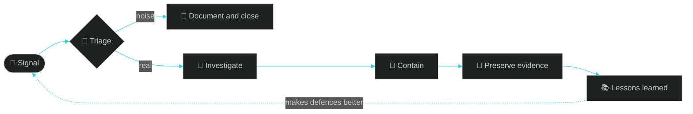

<div align="center">



<br/>


<br/><br/>



</div>



<div align="center">

## `00` // CASE FILE

</div>

```text
┌──────────────────────────────────────────────────────────────┐
│ CASE FILE      GR-2026                          STATUS: OPEN │
├──────────────────────────────────────────────────────────────┤
│ SUBJECT        Grace Ryan                                    │
│ DEGREE         BSc (Hons) Computer Forensics & Security      │
│ INSTITUTION    SETU Waterford                                │
│ FOCUS          Defensive security                            │
│ LOOKING FOR    Graduate roles in cybersecurity               │
└──────────────────────────────────────────────────────────────┘
```


<div align="center">

## `01` // ABOUT ME

I'm a fourth-year BSc (Hons) Computer Forensics & Security student at **SETU Waterford**.

I enjoy security-related projects, tackling CTF challenges, and learning how security issues are investigated and analysed.

I'm finishing my degree and looking for graduate opportunities in cybersecurity.

<br/>

`Better security. Safer tomorrow.`

</div>


<div align="center">

## `02` // HOW I THINK ABOUT AN INCIDENT

<sub>The mindset I'm building towards, from first signal to lessons learned.</sub>

</div>




<div align="center">

## `03` // AREAS OF INTEREST

<table>
<tr>
<td align="center" width="25%">

### 🔎

**Digital Forensics**

<sub>Investigation & analysis</sub>

</td>
<td align="center" width="25%">

### 🛡️

**Defensive Security**

<sub>Security triage</sub>

</td>
<td align="center" width="25%">

### 🚩

**CTF Challenges**

<sub>Problem solving</sub>

</td>
<td align="center" width="25%">

### ⚙️

**Security Tools**

<sub>Practical projects</sub>

</td>
</tr>
</table>

</div>


<div align="center">

## `04` // TECH STACK

**Languages**


**Tools**


</div>


<div align="center">

## `05` // SECURITY LAB

<sub>A closer look at my security-related repositories.</sub>

</div>

<table>
<tr>
<td width="50%" valign="top" align="center">

### 🔎 Security Triage

A security-focused project related to triage workflows.

[](https://github.com/GraceRyan05/security-triage)

</td>
<td width="50%" valign="top" align="center">

### 🛡️ Triage Project

A project related to security triage and analysis.

[](https://github.com/GraceRyan05/Triage-Project)

</td>
</tr>
<tr>
<td width="50%" valign="top" align="center">

### 🐛 Find Evil Free

A Python project. Visit the repository to explore the implementation.

[](https://github.com/GraceRyan05/find-evil-free)

</td>
<td width="50%" valign="top" align="center">

### 🤖 Triage Agent

A Python project related to security triage.

[](https://github.com/GraceRyan05/TriageAgent)

</td>
</tr>
</table>

<div align="center">

[](https://github.com/GraceRyan05?tab=repositories)

</div>


<div align="center">

## `06` // OTHER PROJECTS

| Project | Description | Language |
|:---|:---|:---:|
| [Bookshop Tracker](https://github.com/GraceRyan05/Bookshop-Tracker) | Bookshop tracking application | Kotlin |
| [Personal Library](https://github.com/GraceRyan05/Personal-Library) | Personal book collection manager | Java |
| [Vienna Map](https://github.com/GraceRyan05/ViennaMap-DSA2) | Vienna U-Bahn station data project | Java |
| [Image Viewer](https://github.com/GraceRyan05/Image-Viewer) | Image viewer application | Java |

</div>


<div align="center">

## `07` // THREAT HUNT: MY CONTRIBUTIONS

<sub>A snake hunts down my contribution graph. Every purple square is a day I shipped something.<br/>Regenerated automatically every 12 hours.</sub>

<br/>

<picture>
  <source media="(prefers-color-scheme: dark)" srcset="https://raw.githubusercontent.com/GraceRyan05/GraceRyan05/output/github-snake-dark.svg"/>
  <source media="(prefers-color-scheme: light)" srcset="https://raw.githubusercontent.com/GraceRyan05/GraceRyan05/output/github-snake.svg"/>
  
</picture>

<br/><br/>


</div>


<div align="center">

## `08` // GITHUB ACTIVITY

<a href="https://github.com/GraceRyan05">

</a>

<a href="https://github.com/GraceRyan05">

</a>

<br/><br/>

[](https://github.com/GraceRyan05?tab=achievements)

</div>


<div align="center">

## `09` // EVIDENCE LOCKER

<sub>Expand the file to read it.</sub>

</div>

<details>
<summary><b>🔐 EXHIBIT A — Encrypted note (CTF-style)</b></summary>
<br/>

Found in the evidence locker. Can you read it?

```text
ZmxhZ3tncmFjZV93YXNfaGVyZV8yMDI2fQ==
```

<sub>Hint: it isn't encryption, just encoding. 😉</sub>

</details>


<div align="center">

## `10` // CONNECT

<a href="https://www.linkedin.com/in/grace--ryan/">

</a>

<a href="https://github.com/GraceRyan05">

</a>

</div>

<br/>


